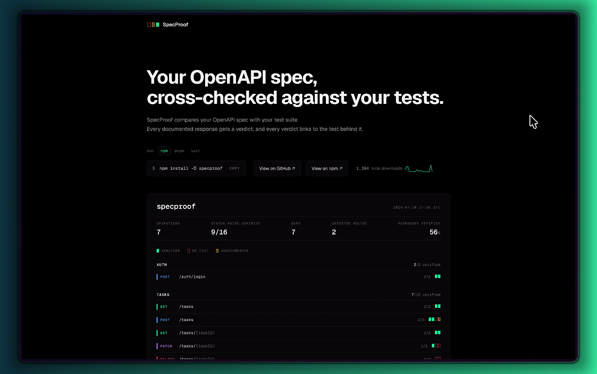

# SpecProof

Audit your API test coverage against your OpenAPI spec. SpecProof cross-examines every operation and response status against your test suite's assertions and renders the verdicts as a browsable report.



## Quick start

```bash
bun add -d specproof
bunx specproof dev          # audit the current repo → http://localhost:3001
bun add -d specproof@latest # update to the latest version
```

Also works with `npm`, `pnpm` and `yarn`.

Starting from scratch works too! SpecProof opens on an empty or half-written spec and rebuilds the report as you add operations, so you can write the spec and watch coverage appear beside it.

## CLI

```bash
specproof generate [--out proof.json] [--check]   # compile the coverage proof
specproof dev                                     # generate + serve the report, rebuilding on change
specproof build && specproof start                # production build + serve
```

Run `specproof --help` for the full option list:

- `--repo`
- `--spec`
- `--out`
- `--port`
- `--allow-empty`
- `--no-watch`

## Using SpecProof in your repo

Browse a live audit at [specproofoss.vercel.app](https://specproofoss.vercel.app).

### CI drift guard

Commit a generated proof in your repo (for example `specproof.json`), regenerate it whenever your OpenAPI spec or tests change, and let CI verify it stays current:

```bash
specproof generate --out specproof.json        # after spec or test edits
specproof generate --out specproof.json --check  # verify only; does not write
```

`--check` compares the file at `--out` to a freshly built proof and exits `1` on drift without modifying the file. A missing spec is a hard failure under `--check` (plain `generate` without `--check` is more permissive). Optional flags such as `--repo`, `--spec`, and `--allow-empty` work the same as on a normal `generate` run.

Example GitHub Actions step (runs after installing SpecProof as a dev dependency):

```yaml
- name: Verify API coverage proof is current
  run: npx specproof generate --out specproof.json --check
```

### Test files SpecProof reads

SpecProof scans every `*.test.ts`, `*.test.tsx`, `*.test.js`, and `*.test.jsx` file under the audited repo. It does not run the tests; it parses the source as text.

For each operation, group tests in a `describe` (or nested `describe`) whose title starts with an HTTP verb and path, for example `describe("GET /tasks", () => { … })`. Supported methods are `GET`, `POST`, `PUT`, `DELETE`, and `PATCH`. Path segments written as `{id}`, `[id]`, or `:id` are treated as the same operation.

Inside those blocks it counts status assertions written as `.status).toBe(NNN)` or `.status).toEqual(NNN)` (three-digit codes). It extracts `it()` / `test()` bodies for the proof view by matching opening calls and closing `})` at the same indentation (with or without a trailing semicolon). Blocks are attributed to the statuses they assert inside the block. When several files describe the same operation, the file with the most `it()` / `test()` blocks wins.

## License

Licensed under the [Apache License, Version 2.0](LICENSE) (Apache-2.0).