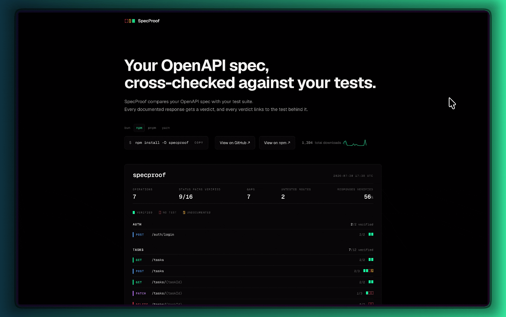

# SpecProof

Audit your API test coverage against your OpenAPI spec. SpecProof cross-examines every operation and response status against your test suite's assertions and renders the verdicts as a browsable report.



## Quick start

```bash
bun add -d specproof
bunx specproof dev          # audit the current repo → http://localhost:3001
bun add -d specproof@latest # update to the latest version
```

Also works with `npm`, `pnpm` and `yarn`.

Starting from scratch works too! SpecProof opens on an empty or half-written spec and rebuilds the report as you add operations, so you can write the spec and watch coverage appear beside it.

## CLI

```bash
specproof generate [--out proof.json] [--check]   # compile the coverage proof
specproof dev                                     # generate + serve the report, rebuilding on change
specproof build && specproof start                # production build + serve
```

Run `specproof --help` for the full option list:

- `--repo`
- `--spec`
- `--out`
- `--port`
- `--allow-empty`
- `--no-watch`

## Production monitoring (Sentry)

The hosted app at [specproofoss.vercel.app](https://specproofoss.vercel.app) reports errors and performance traces to Sentry in **production only** (`VERCEL_ENV=production` or `NODE_ENV=production`). Session replay is disabled.

| Variable | Required | Purpose |
| --- | --- | --- |
| `NEXT_PUBLIC_SENTRY_DSN` / `SENTRY_DSN` | No | Ingest DSN (defaults to the project DSN for the official deployment). Set to an empty string to opt out on self-hosted production builds. |
| `SENTRY_AUTH_TOKEN` | No | Upload source maps during `next build` for readable stack traces in Sentry. Builds succeed without it; upload is skipped. |
| `SENTRY_ORG` | No | Defaults to `durable-quality` (EU). |
| `SENTRY_PROJECT` | No | Defaults to `specproof`. |

On Vercel, add `SENTRY_AUTH_TOKEN` as a secret (create a token at [sentry.io](https://sentry.io) with `project:releases` and `org:read`). `VERCEL_GIT_COMMIT_SHA` is used automatically as the Sentry release.

**Verify:** after deploy, open the site, trigger a client error from devtools (not the console sandbox), or check **Performance → Traces** for pageload spans. Issues appear in the [specproof project](https://durable-quality.sentry.io/) (EU region).

## License

MIT
